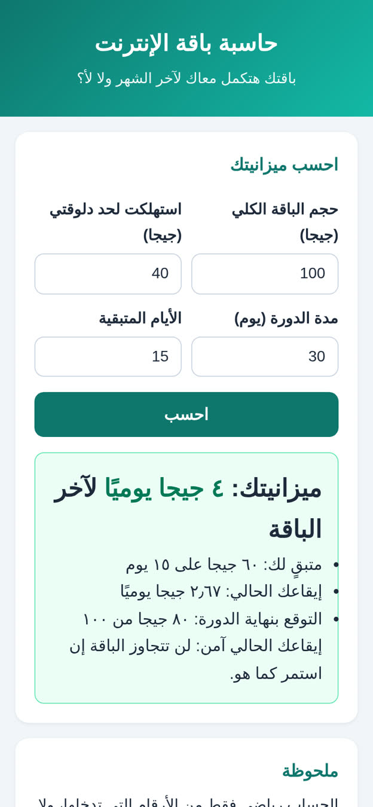

# Internet Data Plan Calculator | حاسبة باقة الإنترنت

Work out your daily gigabyte budget until your plan renews: how much you have used, how many days are left, and whether your current pace will last or run out early. Arabic interface.

**Live app:** https://abood-ayman.github.io/data-plan-ar/

**LinkedIn:** [Project entry](https://www.linkedin.com/in/abdullah-ayman-1678b737b/details/projects/)

This is a personal project, built with AI tools.

## Features
- Daily GB budget left until the plan renews
- Your current consumption pace vs the budget
- Projected total usage at cycle end if your pace holds
- Early warning when you will run out before renewal

## Note
Pure math from the numbers you enter; it does not connect to your carrier account. For exact figures check your carrier app, since some plans count free services or rollover differently.

## Privacy
Everything runs in your browser. No data is stored or sent anywhere.

## Run locally
Open `index.html` in any browser. It is a single static page with no dependencies.

## Status
Stable.

## Copyright
MIT License - Copyright (c) 2026 Abdullah Ayman.
